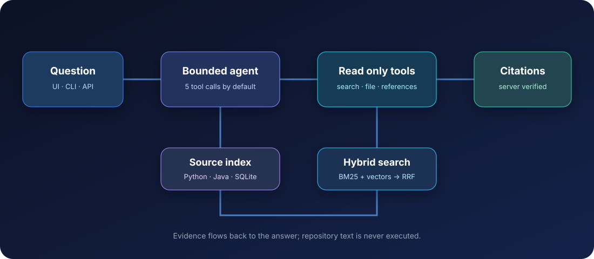
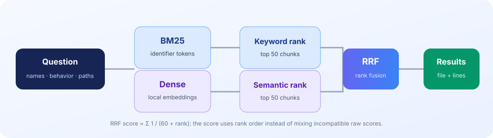

<div align="center">

# 🧭 RepoPilot

**Repository questions, answered with source evidence.**

Index a local Python or Java repository, ask how its code works, and inspect the exact lines behind the answer.



[Quick start](#quick-start) · [How it works](#how-it-works) · [Measured results](#measured-results) · [API](#api)

</div>

## What you get

- **Hybrid code search:** code-aware BM25 and local embeddings combined with reciprocal rank fusion.
- **A bounded investigator:** three read-only tools, a tool-call budget, duplicate detection, and structured final answers.
- **Verified citations:** the server checks paths, line numbers, and whether each cited range was exposed by a tool.
- **Incremental indexing:** changed files are updated; identical chunks reuse cached vectors.
- **A working interface:** Streamlit UI, FastAPI endpoints, and a CLI.
- **Reproducible checks:** a pinned public repository benchmark, a small deterministic fixture, and fake-model tests separate retrieval quality from hosted-model behavior.

## Quick start

Python **3.11 or 3.12** is required. From PowerShell:

```powershell
py -3.12 -m venv .venv
.\.venv\Scripts\Activate.ps1
python -m pip install -r requirements.txt
Copy-Item .env.example .env
```

Create a [Groq API key](https://console.groq.com/keys) and put it in `.env` as `GROQ_API_KEY=...`. Groq [offers a free tier](https://console.groq.com/docs/billing-faqs) with [rate limits](https://console.groq.com/docs/rate-limits); no key is stored in Git. The default `openai/gpt-oss-20b` model [supports tool use](https://console.groq.com/docs/tool-use/overview). If you already use Anthropic, set `REPOPILOT_PROVIDER=anthropic`, `ANTHROPIC_API_KEY`, and optionally `REPOPILOT_ANTHROPIC_MODEL` instead. The first production index downloads the BGE small ONNX model into `.cache/fastembed`; later runs use the cached copy.

In two terminals:

```powershell
uvicorn repopilot.api.main:app --reload --port 8000
streamlit run src/repopilot/ui/app.py
```

Open the Streamlit URL, enter the absolute path of a local repository, click **Index repository**, wait until its status is **ready**, then ask a question. You can also use the CLI:

```powershell
python -m repopilot.cli index C:\path\to\repo
python -m repopilot.cli ask C:\path\to\repo "Where is authentication checked?"
```

For free, offline retrieval experiments, set `REPOPILOT_EMBEDDER=hash` before indexing. Use the same embedder setting for queries against that index.

**Example question:** “How does the login route check a password and create a token?” RepoPilot can search the route, follow `crud.authenticate`, read `create_access_token`, and return file and line citations after checking them against the code it saw.

## How it works

1. The scanner reads `.py` and `.java` files. It skips build directories, large and binary files, generated files, and symlinks.
2. Python chunks come from `ast`; Java chunks use a lightweight declaration heuristic. Every chunk retains its true source line range.
3. BM25 and dense similarity rank chunks. Reciprocal rank fusion combines the top 50 from each list.
4. The model can search, read a numbered file range, or find symbol references. Each tool response is bounded and marked as untrusted repository content.
5. The model submits a structured answer. The server fills snippets from real files and rejects citations it cannot verify.



See [the architecture notes](docs/architecture.md) for the data flow and trust boundaries.

## API

| Method | Path | Purpose |
| --- | --- | --- |
| `POST` | `/repositories/index` | Start indexing a local directory |
| `GET` | `/repositories/{id}/status` | Check progress and errors |
| `POST` | `/query` | Ask a question with a retrieval mode and tool budget |
| `GET` | `/health` | Health check |

FastAPI exposes interactive schemas at `http://127.0.0.1:8000/docs`. A query response contains the answer, evidence status (`supported`, `inferred`, or `insufficient`), verified citations, tool trace, tool count, and latency.

## Measured results

The primary benchmark uses the pinned [`fastapi/full-stack-fastapi-template` snapshot](scripts/fetch_eval_repo.ps1) at commit `f4bcfaba7c85be3c6332cc74a20819f586dcdbc6`. The [28-question dataset](eval/real_dataset.jsonl) has 24 answerable and 4 unanswerable questions. Gold ranges were checked against that commit. The [committed results](eval/results/real_dataset_retrieval.json) use the production BGE small embedder:

| Mode | Recall@3 on 24 answerable questions |
| --- | ---: |
| BM25 | **83.3%** |
| Hybrid | 75.0% |
| Dense | 66.7% |

BM25 wins on this dataset. Many questions name exact functions and routes, which favors keyword matching; dense retrieval contributes less and RRF can move a correct BM25 hit below rank three. This is a small hand-labelled benchmark, not a general performance claim. Recall@3 counts a hit when any of the top three chunks overlaps a gold range. The four unanswerable questions are excluded from recall and reserved for agent abstention testing.

Reproduce the primary benchmark:

```powershell
.\scripts\fetch_eval_repo.ps1
python -m eval.run_eval --repo data/eval_repo --dataset eval/real_dataset.jsonl
```

The fetch script refuses to overwrite an existing checkout. If you have already fetched it, run the second command alone. To run a hosted answer evaluation after adding your API key, add `--agent --judge`; use `--limit 3` for a small trial within your provider's limits. The judge grades answer correctness against reference facts; review its judgments before treating that score as a final result. No hosted answer score is claimed in the committed results.

### Fast offline fixture

The committed [20-question fixture dataset](eval/dataset.jsonl) contains 16 answerable and 4 unanswerable questions about [a small sample repository](tests/fixtures/sample_repo). Its source ranges were checked against the files. Run the offline retrieval comparison with:

```powershell
$env:REPOPILOT_EMBEDDER = "hash"
python -m eval.run_eval --offline
```

The [fixture results](eval/results/dataset_retrieval.json) are:

| Mode | Recall@3 on 16 answerable questions |
| --- | ---: |
| Hybrid | 100% |
| BM25 | 100% |
| Dense | 100% |

This tiny fixture checks that all modes run and find obvious symbols. It is not a quality comparison.

## Tests

```powershell
python -m pytest -q -m "not integration"
```

Tests cover discovery, line preservation, tokenization, search, path traversal, provenance, references, and a scripted fake model. CI runs the same suite and offline evaluation on every push and pull request.

The full suite passed locally on Windows with Python 3.12: **12 passed**. An upstream Starlette `TestClient` deprecation warning remains. The production embedder successfully indexed the pinned repository. One live Groq query found `create_access_token` in `backend/app/core/security.py:22-26` and returned a verified citation after two tool calls. This is a smoke check, not an answer-quality benchmark; CI tests the Groq adapter with a mock HTTP server and needs no API key.

## Limits and design choices

- Java declaration parsing and references are heuristic; Python AST analysis is more reliable.
- Local BM25 ranks in memory; SQLite stores vectors as JSON per chunk. This favors readability and a few thousand chunks over maximum scale. A dedicated search engine becomes appropriate for very large repositories.
- Citation verification proves source provenance and range validity. It does not establish that the prose faithfully interprets the code.
- RepoPilot is intended to run locally. If you expose the API to other users, set `REPOPILOT_ALLOWED_ROOTS` and add authentication before accepting arbitrary paths.
- The production embedder downloads a model on first use, and hosted answers require a Groq or Anthropic key. Offline tests use a deterministic hash embedder.
- The pinned upstream repository includes syntax newer than Python 3.12 in one file; RepoPilot falls back to line windows for files the local AST cannot parse.

## Repository map

```text
src/repopilot/   scanner, chunker, index, retrieval, agent, API, UI, CLI
eval/            pinned-repo labels, fixture labels, benchmark runner, results
tests/           offline tests and sample repository
docs/            architecture notes and figures
scripts/         pinned evaluation repository fetcher
```

MIT license. Built to keep code investigation inspectable, bounded, and honest about its evidence.
