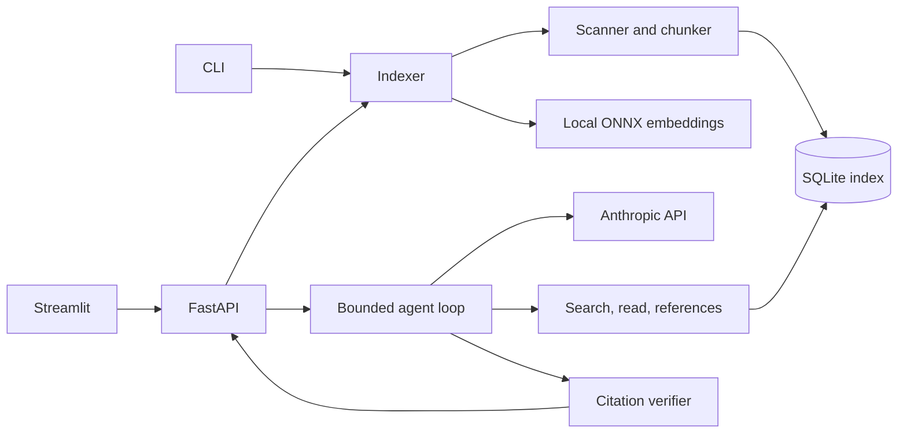

# Architecture

The indexer reads only `.py` and `.java` source files, preserves absolute line numbers in each chunk, and updates changed files. Search combines in-process BM25 and cosine similarity through reciprocal rank fusion. The agent receives bounded, marked tool output and can only read. The verifier checks cited paths, line ranges, and whether a tool exposed those ranges during the investigation.

## Data storage

Each repository is assigned the first 12 hex characters of the SHA-1 digest of its resolved absolute path. Its index lives in `data/<id>/meta.sqlite`. The database holds source chunks, vectors, file hashes, and indexing status. On subsequent runs, unchanged files are skipped and vectors for identical content are reused.

## Trust boundaries

The repository may contain hostile instructions. Its text is delivered inside `tool_result untrusted=true` delimiters, and the system prompt forbids following those instructions. Tools do not execute or write repository code. `read_file` resolves paths against the root and rejects escapes. A verified citation only means the cited lines exist and were exposed to the model; it does not prove the answer is logically correct.
